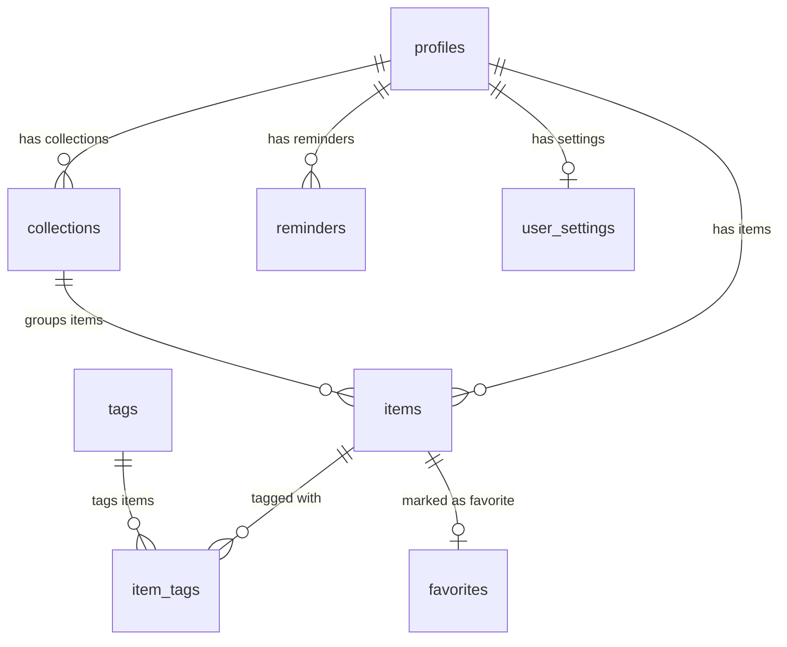

# PostgreSQL Database Schema & RLS Policies

This document details the production-ready PostgreSQL schema, indexes, relationships, and Row Level Security (RLS) policies implemented for the Drop Vault backend in Supabase.

---

## 1. Entity Relationship (ER) Diagram



---

## 2. Table Definitions

### `profiles`
Stores public user profile information.
*   **`id`** (`uuid`, primary key, references `auth.users(id) on delete cascade`)
*   **`user_id`** (`uuid` default `auth.uid()`, references `auth.users(id) on delete cascade`)
*   **`full_name`** (`text` not null)
*   **`email`** (`text` not null)
*   **`avatar_url`** (`text`, nullable)
*   **`join_date`** (`timestamp with time zone` default `now()`)
*   **`created_at`** (`timestamp with time zone` default `now()`)
*   **`updated_at`** (`timestamp with time zone` default `now()`)

### `collections`
User-defined folders for organizing vault items.
*   **`id`** (`uuid`, primary key)
*   **`user_id`** (`uuid` default `auth.uid()`, references `auth.users(id) on delete cascade`)
*   **`name`** (`text` not null)
*   **`description`** (`text` default '')
*   **`created_at`** (`timestamp with time zone` default `now()`)
*   **`updated_at`** (`timestamp with time zone` default `now()`)

### `items`
The core vault items (notes, links, images, files).
*   **`id`** (`uuid`, primary key)
*   **`user_id`** (`uuid` default `auth.uid()`, references `auth.users(id) on delete cascade`)
*   **`title`** (`text` not null)
*   **`type`** (`text` not null)
*   **`content`** (`text` not null)
*   **`collection_name`** (`text` not null)
*   **`category`** (`text`, nullable)
*   **`is_trash`** (`boolean` default `false` not null)
*   **`created_at`** (`timestamp with time zone` default `now()`)
*   **`updated_at`** (`timestamp with time zone` default `now()`)

### `favorites`
Explicitly tracks favorited vault items.
*   **`id`** (`uuid`, primary key)
*   **`user_id`** (`uuid` default `auth.uid()`, references `auth.users(id) on delete cascade`)
*   **`item_id`** (`uuid` references `public.items(id) on delete cascade`)
*   **`created_at`** (`timestamp with time zone` default `now()`)
*   **`updated_at`** (`timestamp with time zone` default `now()`)

### `reminders`
Notification triggers for reviewing items.
*   **`id`** (`uuid`, primary key)
*   **`user_id`** (`uuid` default `auth.uid()`, references `auth.users(id) on delete cascade`)
*   **`title`** (`text` not null)
*   **`collection_name`** (`text` not null)
*   **`date_time`** (`timestamp with time zone` not null)
*   **`is_completed`** (`boolean` default `false` not null)
*   **`item_id`** (`uuid` nullable references `public.items(id) on delete cascade`)
*   **`created_at`** (`timestamp with time zone` default `now()`)
*   **`updated_at`** (`timestamp with time zone` default `now()`)

### `tags`
Unique user-created tags.
*   **`id`** (`uuid`, primary key)
*   **`user_id`** (`uuid` default `auth.uid()`, references `auth.users(id) on delete cascade`)
*   **`name`** (`text` not null)
*   **`created_at`** (`timestamp with time zone` default `now()`)
*   **`updated_at`** (`timestamp with time zone` default `now()`)
*   *Constraint: Unique constraint on `(user_id, name)`*

### `item_tags`
Link table between `items` and `tags`.
*   **`id`** (`uuid`, primary key)
*   **`user_id`** (`uuid` default `auth.uid()`, references `auth.users(id) on delete cascade`)
*   **`item_id`** (`uuid` references `public.items(id) on delete cascade`)
*   **`tag_id`** (`uuid` references `public.tags(id) on delete cascade`)
*   **`created_at`** (`timestamp with time zone` default `now()`)
*   **`updated_at`** (`timestamp with time zone` default `now()`)
*   *Constraint: Unique constraint on `(item_id, tag_id)`*

### `user_settings`
Granular user settings, search history, custom category listings.
*   **`id`** (`uuid`, primary key)
*   **`user_id`** (`uuid` default `auth.uid()`, references `auth.users(id) on delete cascade` unique)
*   **`notifications_enabled`** (`boolean` default `true` not null)
*   **`reminders_enabled`** (`boolean` default `false` not null)
*   **`auto_sync_enabled`** (`boolean` default `true` not null)
*   **`recent_searches`** (`jsonb` default `[]`::jsonb not null)
*   **`link_categories`** (`jsonb` default `["GitHub", "YouTube", "Instagram", "Website", "Others"]`::jsonb not null)
*   **`theme_mode`** (`text` default 'system')
*   **`created_at`** (`timestamp with time zone` default `now()`)
*   **`updated_at`** (`timestamp with time zone` default `now()`)

---

## 3. SQL DDL & RLS Migration Script

Execute the following script in the Supabase SQL Editor:

```sql
-- Enable UUID extension
create extension if not exists "uuid-ossp";

-- 1. PROFILES TABLE
create table if not exists public.profiles (
  id uuid references auth.users on delete cascade primary key,
  user_id uuid references auth.users on delete cascade default auth.uid(),
  full_name text not null,
  email text not null,
  join_date timestamp with time zone default now() not null,
  avatar_url text,
  settings jsonb default '{"notificationsEnabled": true, "remindersEnabled": false, "autoSyncEnabled": true}'::jsonb not null,
  created_at timestamp with time zone default now() not null,
  updated_at timestamp with time zone default now() not null
);

-- 2. COLLECTIONS TABLE
create table if not exists public.collections (
  id uuid primary key,
  user_id uuid references auth.users on delete cascade default auth.uid() not null,
  name text not null,
  description text default '' not null,
  created_at timestamp with time zone default now() not null,
  updated_at timestamp with time zone default now() not null
);

-- 3. ITEMS TABLE
create table if not exists public.items (
  id uuid primary key,
  user_id uuid references auth.users on delete cascade default auth.uid() not null,
  title text not null,
  type text not null,
  content text not null,
  collection_name text not null,
  category text,
  is_trash boolean default false not null,
  created_at timestamp with time zone default now() not null,
  updated_at timestamp with time zone default now() not null
);

-- 4. FAVORITES TABLE
create table if not exists public.favorites (
  id uuid primary key,
  user_id uuid references auth.users on delete cascade default auth.uid() not null,
  item_id uuid references public.items(id) on delete cascade not null,
  created_at timestamp with time zone default now() not null,
  updated_at timestamp with time zone default now() not null
);

-- 5. REMINDERS TABLE
create table if not exists public.reminders (
  id uuid primary key,
  user_id uuid references auth.users on delete cascade default auth.uid() not null,
  title text not null,
  collection_name text not null,
  date_time timestamp with time zone not null,
  is_completed boolean default false not null,
  item_id uuid references public.items(id) on delete cascade,
  created_at timestamp with time zone default now() not null,
  updated_at timestamp with time zone default now() not null
);

-- 6. TAGS TABLE
create table if not exists public.tags (
  id uuid primary key,
  user_id uuid references auth.users on delete cascade default auth.uid() not null,
  name text not null,
  created_at timestamp with time zone default now() not null,
  updated_at timestamp with time zone default now() not null,
  constraint tags_user_id_name_key unique (user_id, name)
);

-- 7. ITEM TAGS LINK TABLE
create table if not exists public.item_tags (
  id uuid primary key,
  user_id uuid references auth.users on delete cascade default auth.uid() not null,
  item_id uuid references public.items(id) on delete cascade not null,
  tag_id uuid references public.tags(id) on delete cascade not null,
  created_at timestamp with time zone default now() not null,
  updated_at timestamp with time zone default now() not null,
  constraint item_tags_item_id_tag_id_key unique (item_id, tag_id)
);

-- 8. USER SETTINGS TABLE
create table if not exists public.user_settings (
  id uuid primary key,
  user_id uuid references auth.users on delete cascade default auth.uid() not null unique,
  notifications_enabled boolean default true not null,
  reminders_enabled boolean default false not null,
  auto_sync_enabled boolean default true not null,
  recent_searches jsonb default '[]'::jsonb not null,
  link_categories jsonb default '["GitHub", "YouTube", "Instagram", "Website", "Others"]'::jsonb not null,
  theme_mode text default 'system' not null,
  created_at timestamp with time zone default now() not null,
  updated_at timestamp with time zone default now() not null
);

---

## 4. Triggers for Automatic Column Modification

```sql
create or replace function public.update_updated_at_column()
returns trigger as $$
begin
  new.updated_at = now();
  return new;
end;
$$ language plpgsql;

create or replace trigger set_profiles_updated_at before update on public.profiles for each row execute procedure public.update_updated_at_column();
create or replace trigger set_collections_updated_at before update on public.collections for each row execute procedure public.update_updated_at_column();
create or replace trigger set_items_updated_at before update on public.items for each row execute procedure public.update_updated_at_column();
create or replace trigger set_favorites_updated_at before update on public.favorites for each row execute procedure public.update_updated_at_column();
create or replace trigger set_reminders_updated_at before update on public.reminders for each row execute procedure public.update_updated_at_column();
create or replace trigger set_tags_updated_at before update on public.tags for each row execute procedure public.update_updated_at_column();
create or replace trigger set_item_tags_updated_at before update on public.item_tags for each row execute procedure public.update_updated_at_column();
create or replace trigger set_user_settings_updated_at before update on public.user_settings for each row execute procedure public.update_updated_at_column();
```

---

## 5. Row Level Security (RLS) Configuration

All tables have RLS enabled. Users can only access their own records.

```sql
-- Enable RLS
alter table public.profiles enable row level security;
alter table public.collections enable row level security;
alter table public.items enable row level security;
alter table public.favorites enable row level security;
alter table public.reminders enable row level security;
alter table public.tags enable row level security;
alter table public.item_tags enable row level security;
alter table public.user_settings enable row level security;

-- Policies for profiles
create policy "Users can access their own profile" on public.profiles for all using (auth.uid() = id) with check (auth.uid() = id);

-- Policies for collections
create policy "Users can access their own collections" on public.collections for all using (auth.uid() = user_id) with check (auth.uid() = user_id);

-- Policies for items
create policy "Users can access their own items" on public.items for all using (auth.uid() = user_id) with check (auth.uid() = user_id);

-- Policies for favorites
create policy "Users can access their own favorites" on public.favorites for all using (auth.uid() = user_id) with check (auth.uid() = user_id);

-- Policies for reminders
create policy "Users can access their own reminders" on public.reminders for all using (auth.uid() = user_id) with check (auth.uid() = user_id);

-- Policies for tags
create policy "Users can access their own tags" on public.tags for all using (auth.uid() = user_id) with check (auth.uid() = user_id);

-- Policies for item_tags
create policy "Users can access their own item_tags" on public.item_tags for all using (auth.uid() = user_id) with check (auth.uid() = user_id);

-- Policies for user_settings
create policy "Users can access their own user_settings" on public.user_settings for all using (auth.uid() = user_id) with check (auth.uid() = user_id);
```

---

## 6. Optimization Indexes

```sql
create index if not exists collections_user_id_idx on public.collections(user_id);
create index if not exists items_user_id_idx on public.items(user_id);
create index if not exists items_user_id_is_trash_idx on public.items(user_id, is_trash);
create index if not exists favorites_user_id_idx on public.favorites(user_id);
create index if not exists reminders_user_id_idx on public.reminders(user_id);
create index if not exists tags_user_id_idx on public.tags(user_id);
create index if not exists item_tags_user_id_idx on public.item_tags(user_id);
```
